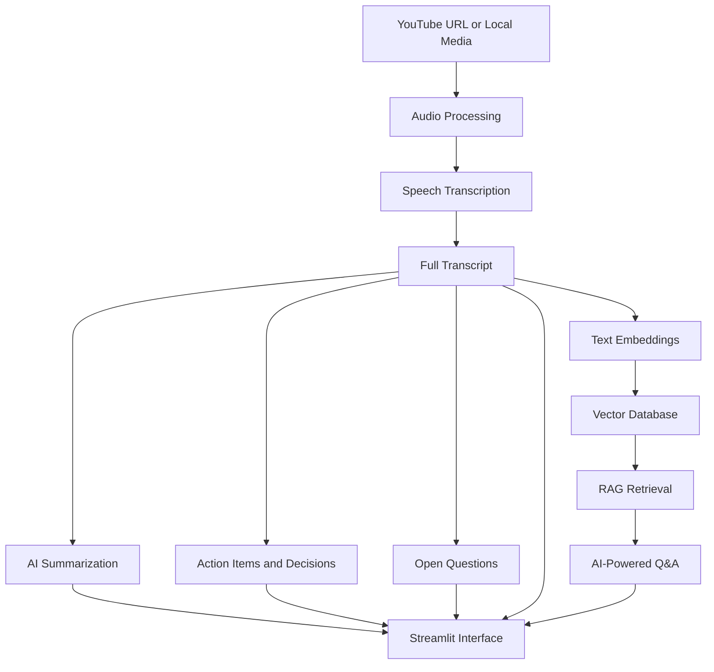

# 🎬 AI Video Assistant

An AI-powered video and meeting assistant that transforms YouTube videos and local audio/video recordings into searchable, structured insights. It combines speech transcription, AI summarization, action-item extraction, and Retrieval-Augmented Generation (RAG) to help users understand video content more efficiently.

## ✨ Features

- **🎥 Multiple Input Sources:** Process YouTube videos and local audio/video files.
- **🎙️ Speech Transcription:** Convert spoken content into text using Whisper and supported transcription services.
- **🌐 Language Support:** Support for English and Hinglish workflows, depending on the selected transcription method and API configuration.
- **📝 AI Summarization:** Generate concise summaries of lengthy recordings.
- **✅ Action Item Extraction:** Identify tasks and follow-up items discussed in a video or meeting.
- **🔑 Decision Extraction:** Extract important decisions and outcomes.
- **❓ Open Question Detection:** Highlight unresolved questions and topics requiring further discussion.
- **💬 Conversational Q&A:** Ask questions about a processed video using a Retrieval-Augmented Generation (RAG) pipeline.
- **🖥️ Web Interface:** Interact with the application through a Streamlit interface.
- **⌨️ Command-Line Interface:** Run the processing workflow through a Python script.

## 🛠️ Tech Stack

| Component                        | Technology                           |
| -------------------------------- | ------------------------------------ |
| Programming Language             | Python                               |
| User Interface                   | Streamlit                            |
| Speech Recognition               | OpenAI Whisper                       |
| Audio and Video Processing       | FFmpeg, yt-dlp, pydub                |
| LLM Integration                  | Mistral AI                           |
| Transcription Service            | Sarvam AI, where configured          |
| LLM Orchestration                | LangChain                            |
| Text Embeddings                  | Hugging Face Sentence Transformers   |
| Vector Database                  | ChromaDB                             |
| Retrieval and Question Answering | Retrieval-Augmented Generation (RAG) |

## 🏗️ Architecture



## 📂 Project Structure

```text
AI-Video-Assistant/
├── app.py
├── main.py
├── Requirements.txt
├── test.py
├── core/
│   ├── extractor.py
│   ├── rag_engine.py
│   ├── summarizer.py
│   ├── transcriber.py
│   └── vector_store.py
├── utils/
│   └── audio_processor.py
├── .gitignore
└── README.md
```

### Main Components

- **`app.py`** — Streamlit web application.
- **`main.py`** — Command-line processing workflow.
- **`core/transcriber.py`** — Speech-to-text processing.
- **`core/summarizer.py`** — Summary generation and title creation.
- **`core/extractor.py`** — Extraction of action items, decisions, and open questions.
- **`core/vector_store.py`** — Vector storage and retrieval utilities.
- **`core/rag_engine.py`** — Retrieval-Augmented Generation and transcript-based question answering.
- **`utils/audio_processor.py`** — Audio downloading, conversion, and preprocessing.
- **`test.py`** — Project test or pipeline script.

## 🚀 Getting Started

### Prerequisites

Before running the application, ensure you have:

- Python 3.10–3.12 recommended.
- Git.
- FFmpeg installed and accessible from your terminal.
- A Mistral AI API key for supported LLM functionality.
- A Sarvam AI API key if you use a transcription workflow that requires it.

### 1. Clone the Repository

```bash
git clone https://github.com/ayushzag/AI-Video-Assistant.git
cd AI-Video-Assistant
```

### 2. Install FFmpeg

**macOS**

```bash
brew install ffmpeg
```

**Ubuntu/Debian**

```bash
sudo apt update
sudo apt install ffmpeg
```

Verify the installation:

```bash
ffmpeg -version
```

On Windows, install FFmpeg and add its `bin` directory to your system PATH.

### 3. Create a Virtual Environment

```bash
python3 -m venv .venv
source .venv/bin/activate
```

On Windows PowerShell:

```powershell
python -m venv .venv
.venv\Scripts\Activate.ps1
```

### 4. Install Python Dependencies

Run this command from the project root:

```bash
python -m pip install --upgrade pip
python -m pip install -r Requirements.txt
```

### 5. Configure API Keys

Create a `.env` file in the project root and add your credentials:

```env
MISTRAL_API_KEY=your_mistral_api_key
SARVAM_API_KEY=your_sarvam_api_key
WHISPER_MODEL=small
```

Replace the example values with your own credentials. Set only the keys required by your chosen workflow.

API key resources:

- [Mistral AI](https://console.mistral.ai/)
- [Sarvam AI](https://dashboard.sarvam.ai/)

**Security:** Never commit your `.env` file, API keys, or other credentials to GitHub.

## ▶️ Running the Application

### Option 1: Streamlit Web Interface

Start the web application:

```bash
streamlit run app.py
```

Open the local URL printed in your terminal, typically:

```text
http://localhost:8501
```

Provide a supported video URL or local media file and follow the interface to process the content and explore the generated insights.

### Option 2: Command-Line Interface

Run:

```bash
python main.py
```

Follow the prompts to provide your media source and the required options. The CLI workflow is intended for processing content and interacting with the generated results.

## 🔄 Processing Workflow

1. **Input:** Provide a YouTube URL or a local audio/video source.
2. **Audio Processing:** Extract and prepare the audio for transcription.
3. **Transcription:** Convert the audio into text using the configured speech-recognition workflow.
4. **Summarization:** Generate a concise summary of the transcript.
5. **Information Extraction:** Identify action items, key decisions, and open questions.
6. **Indexing:** Convert transcript content into embeddings and store it in the vector database.
7. **Retrieval:** Retrieve relevant transcript passages for a user's question.
8. **Question Answering:** Generate a contextual response using the retrieved transcript information.

## 🧪 Testing

The repository includes a `test.py` script.

Run it with:

```bash
python test.py
```

Some processing paths may require configured API keys, installed system dependencies, or downloaded model files.

## ⚠️ Important Notes

- Processing time depends on the duration of the recording, model size, and available hardware.
- Initial runs may download speech-recognition models and embedding models.
- YouTube downloads can fail because of connectivity, availability, or platform restrictions. Local media files provide an alternative input method.
- Cloud-based LLM or transcription services may transmit relevant text or audio to those providers. Review their privacy policies before processing sensitive recordings.
- AI-generated summaries and extracted action items should be checked against the original transcript.

## 🔐 Security and Privacy

- Keep credentials in environment variables or a local `.env` file.
- Do not upload recordings, transcripts, or private meeting data to public repositories.
- Use appropriate access controls when deploying the application for other users.
- Review the data-handling practices of any external API provider you configure.
